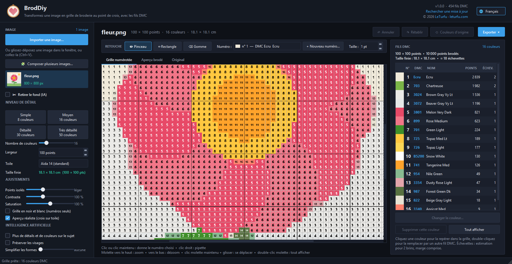
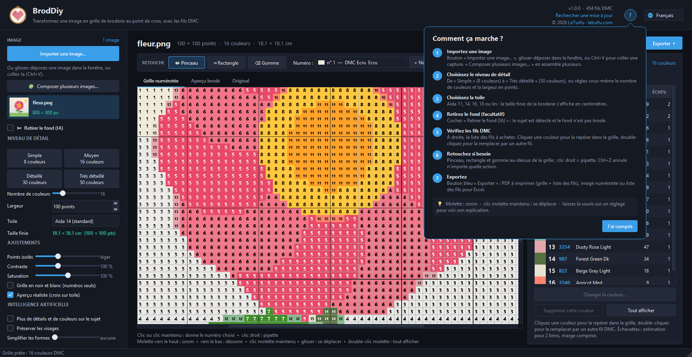
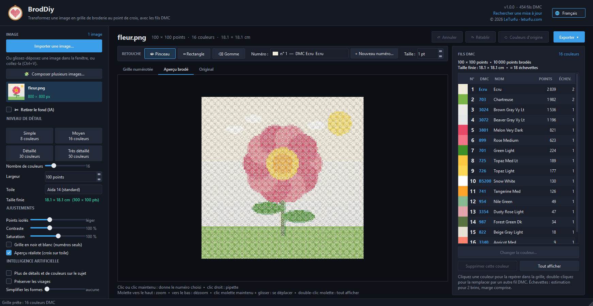

# BrodDiy

Transformez n'importe quelle image en **grille de broderie au point de croix**, avec les **codes couleur DMC** : 454 fils de la gamme officielle, la liste des fils à acheter et une grille numérotée prête à imprimer.

## Télécharger

👉 **[BrodDiy.exe](https://github.com/dev-leturfu/BrodDiy/releases/latest/download/BrodDiy.exe)** (Windows 10 / 11, dernière version)

Un seul fichier, rien à installer. Au premier lancement, BrodDiy se prépare pendant quelques secondes, puis s'ouvre en 2 secondes environ les fois suivantes.

## Fonctionnalités

- **Importer une image** : bouton, `Ctrl + O`, glisser-déposer dans la fenêtre ou `Ctrl + V` pour coller une capture. Les zones transparentes d'un PNG ne sont pas brodées.
- **Composer plusieurs images** sur une même toile : déplacer, agrandir, tourner, retourner, ordonner les calques. Le fond peut être transparent, blanc ou d'une couleur au choix.
- **Niveau de détail** en un clic, ou réglage précis :

  | Préréglage | Couleurs | Largeur |
  | --- | --- | --- |
  | Simple | 8 | 60 points |
  | Moyen | 16 | 100 points |
  | Détaillé | 30 | 150 points |
  | Très détaillé | 50 | 220 points |

- **Toile au choix** : Aida 11, 14, 16, 18 ou lin. La taille finie s'affiche en centimètres.
- **Liste des fils DMC** : code, nom, nombre de points et nombre d'échevettes à prévoir.
  - Cliquez sur une couleur pour la repérer dans la grille.
  - Remplacez-la par un autre fil (recherche par code ou par nom), ou supprimez-la.
- **Retouches à la souris** : pinceau, rectangle, gomme et pipette.
- **Annuler / Rétablir** (`Ctrl + Z` / `Ctrl + Y`) sur toutes les actions, jusqu'à 100 étapes.
- **Intelligence artificielle** :
  - **retirer le fond** : le sujet principal est détecté et le fond n'est pas brodé, ou il est brodé avec le fil de votre choix ;
  - **préserver les visages** : ils gardent plus de couleurs et leurs petits détails ;
  - **simplifier les formes** : les dégradés deviennent des aplats, plus faciles à broder.
- **Exports** :
  - **PDF** A4 à imprimer : page de garde avec la liste des fils, puis la grille découpée en pages numérotées ;
  - **image** PNG ou JPG de la grille numérotée avec sa légende ;
  - **CSV** de la liste des fils, qui s'ouvre dans Excel.
- **Aide intégrée** : le bouton **?** en haut de la fenêtre ouvre une bulle qui explique, étape par étape, comment passer d'une image à une grille prête à broder. Elle s'affiche aussi toute seule au premier lancement.
- **6 langues** : français, anglais, espagnol, allemand, italien et arabe.
- **Mises à jour automatiques** : l'application vous prévient quand une nouvelle version sort et l'installe en un clic.

### Aide « Comment ça marche ? »

### Aperçu brodé

## Remarques

- Windows SmartScreen peut afficher un avertissement au premier lancement, car le programme n'est pas signé : cliquez sur *Informations complémentaires*, puis sur *Exécuter quand même*.
- Le nombre d'échevettes est une estimation pour une broderie à 2 brins sur Aida 14, avec 15 % de marge.

© 2026 LeTurfu — [leturfu.com](https://leturfu.com)
